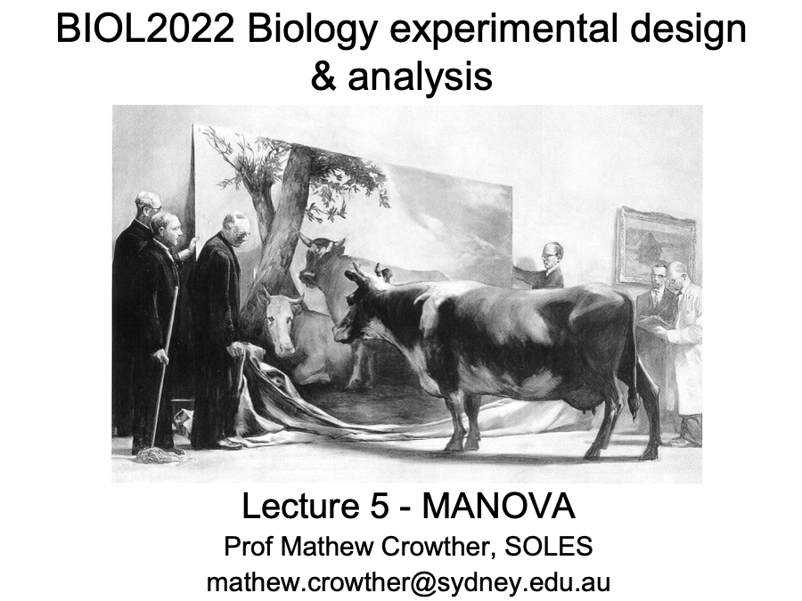
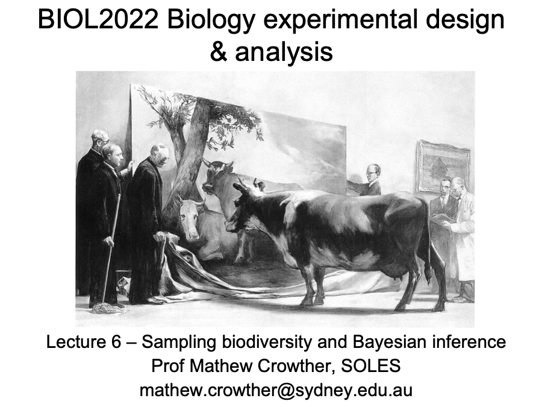

::: {.lecture-actions}
**Tuesday: Multivariate analysis of variance (MANOVA)** [<i class="bi bi-box-arrow-up-right" aria-hidden="true"></i> Open in Canvas](canvas:/pages/week-11-tue-multivariate-analysis-of-variance-manova){.lecture-action target="_blank" rel="noopener noreferrer"}
:::

::: {.content-visible when-format="html"}
```{=html}
<a href="canvas:/pages/week-11-tue-multivariate-analysis-of-variance-manova" class="lecture-deck-preview lecture-deck-image" target="_blank" rel="noopener noreferrer">
  
</a>
```
:::

::: {.lecture-actions}
**Wednesday: Rarefaction and Bayesian analysis** [<i class="bi bi-box-arrow-up-right" aria-hidden="true"></i> Open in Canvas](canvas:/pages/week-12-tue-rarefaction-and-bayesian-analysis){.lecture-action target="_blank" rel="noopener noreferrer"}
:::

::: {.content-visible when-format="html"}
```{=html}
<a href="canvas:/pages/week-12-tue-rarefaction-and-bayesian-analysis" class="lecture-deck-preview lecture-deck-image" target="_blank" rel="noopener noreferrer">
  
</a>
```
:::

::: {.lecture-week-nav}
[← Week 10: Clustering and multidimensional scaling](../L10/index.qmd){.lecture-previous}

[Week 12: Module 3 revision and exam revision Part 1 →](../L12/index.qmd){.lecture-next}
:::
